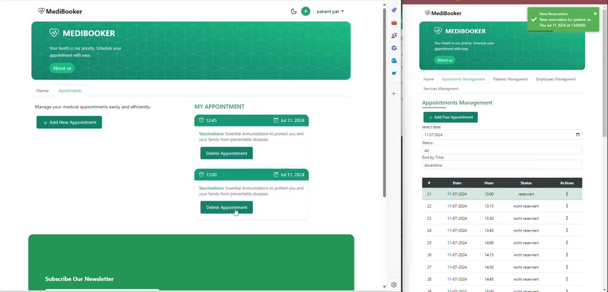

# MediBooker

Online appointment booking for medical practices. Patients see free slots and book or cancel appointments online, and the practice team manages patients, staff, services and the schedule in one place. New bookings show up for the practice in real time.

Team project at Hochschule Bremen (Medieninformatik), 2024.



A short demo video is on my portfolio: [oussama-ben-abid.vercel.app](https://oussama-ben-abid.vercel.app)

## Features

**For patients**
- Register and log in
- Pick a date in the calendar, see the free time slots and book an appointment
- See upcoming appointments, with a countdown when an appointment is today
- Cancel an appointment

**For the practice**
- Manage patients, employees and services: add, edit, delete and filter
- Appointment management with pagination, status filter and sorting by time
- Real-time updates and a notification when a patient books an appointment

## Tech stack

- **Frontend (this repo):** Angular 17, TypeScript, Bootstrap, Socket.IO client, SweetAlert2
- **Backend:** Node.js, Express, Sequelize, MySQL, JWT, Socket.IO, Swagger, see [MediBooker-ApI](https://github.com/oussama-abid/MediBooker-ApI)

## My contribution

 frontend: the booking flow with the calendar, the appointment countdown, the admin area for patients, employees, services and appointments, and the real-time updates over WebSockets. In the API, I worked on the database model and migrations, the JWT login and the appointment and service endpoints.

## Run locally

```bash
npm install
ng serve
```

Then open http://localhost:4200. The app expects the API to be running; its URL is set in `src/enviroments/enviroment.ts`.
